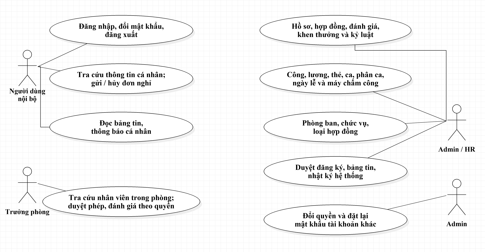
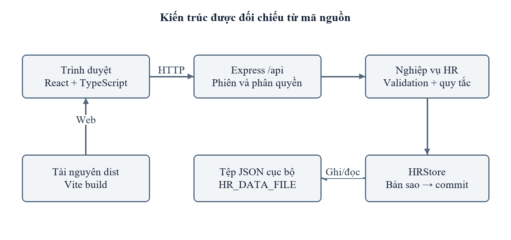
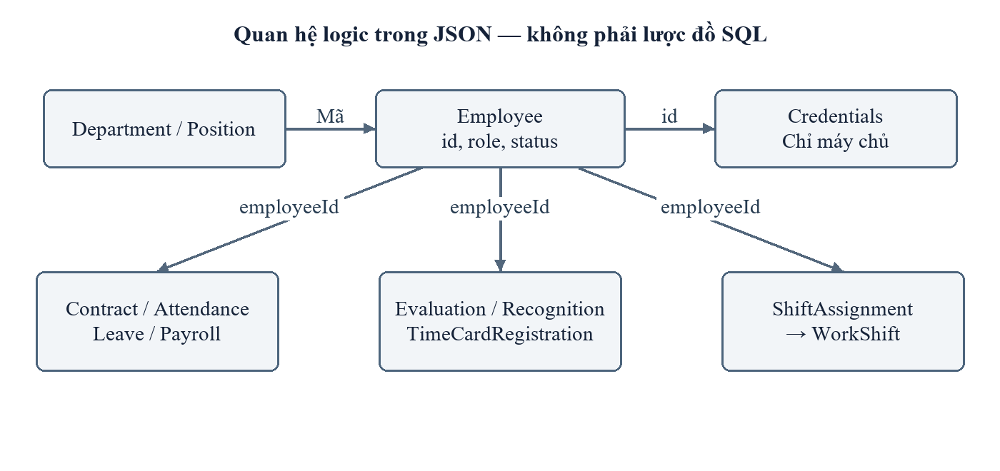
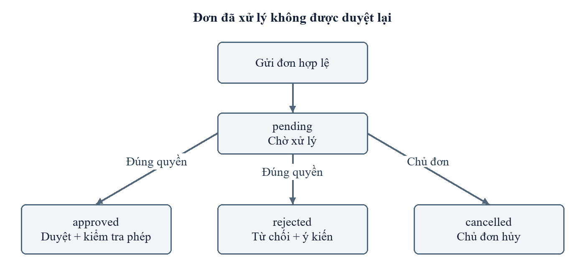
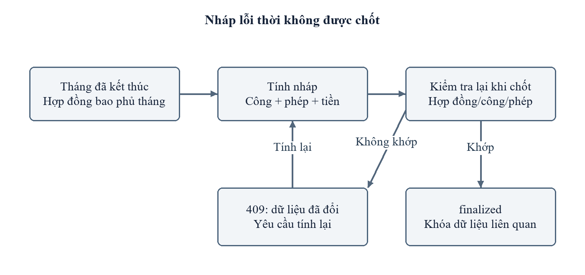

# CHECKPOINT 03 — THIẾT KẾ HỆ THỐNG

**Đề tài:** Xây dựng hệ thống quản lý nhân sự (SHC Company)
**Sinh viên:** Bùi Đức Dũng — MSV 523100077 — Lớp 523100B
**GVHD:** ThS. Trần Thị Lụa
**Yêu cầu checkpoint (Quy định Đồ án kỳ khóa 523):** Kiến trúc, CSDL, API/luồng xử lý, UI/UX tùy loại đề tài.
**Minh chứng tối thiểu:** Sơ đồ/thiết kế phù hợp; phiên bản đã cập nhật theo góp ý.
**Kết quả cần đạt:** Có thiết kế đủ để bắt đầu triển khai.

| Hạng mục thiết kế | Minh chứng | Mục trong báo cáo |
|---|---|---|
| Use case tổng quan | [`hinh/use_case_tong_quan.png`](hinh/use_case_tong_quan.png) | 2.2, Hình 2.1 |
| Kiến trúc phân lớp | [`hinh/architecture.png`](hinh/architecture.png) | 2.3, Hình 2.26 |
| Mô hình dữ liệu (quan hệ giữa các thực thể) | [`hinh/data_relations.png`](hinh/data_relations.png) | 2.4, Hình 2.27 |
| Luồng xử lý nghỉ phép | [`hinh/leave_flow.png`](hinh/leave_flow.png) | 2.2.3 |
| Luồng tính và chốt lương | [`hinh/payroll_flow.png`](hinh/payroll_flow.png) | 2.2.4 |
| Kiểu dữ liệu (nguồn) | [`src/hr/types.ts`](../../src/hr/types.ts) | 2.4.2 – 2.4.9 |
| Danh mục API (nguồn) | [`src/backend/hr/api.ts`](../../src/backend/hr/api.ts) | 2.5.2 – 2.5.3 |
| Thiết kế UI/UX | [`docs/UI_UX_SHC.md`](../../docs/UI_UX_SHC.md) | 2.5.1 |

---

## 1. Use case tổng quan

Hệ thống có 4 tác nhân: **Quản trị viên (admin)**, **Nhân sự (hr)**, **Trưởng phòng (manager)**, **Nhân viên (employee)** và khách chưa đăng nhập (đăng ký công khai). Mọi chức năng nội bộ đều «include» Đăng nhập.

## 2. Kiến trúc hệ thống

Kiến trúc phân lớp trong **một tiến trình Node.js**:

| Lớp | Thành phần | Tệp |
|---|---|---|
| Giao diện | React 19 + TypeScript, build bằng Vite 6 | `src/App.tsx`, `src/hr/HRApp.tsx`, `src/hr/LoginPage.tsx`, `src/landing/` |
| Máy chủ / API | Express 4, router gắn tại `/api` | `server.ts`, `src/backend/hr/api.ts` |
| Quy tắc nghiệp vụ | Kiểm tra ngày hợp lệ, đếm ngày công, giao khoảng thời gian | `src/backend/hr/rules.ts` |
| Lưu trữ | `HRStore` — tệp JSON, giao dịch ghi nguyên tử (tệp `.tmp` + đổi tên) | `src/backend/hr/store.ts` |

Đường đi của một yêu cầu: Trình duyệt → `fetch` JSON + cookie `hr_session` → Express → kiểm tra phiên, vai trò, phòng ban và dữ liệu → `HRStore.transaction()` → ghi tệp → trả JSON đã lọc theo vai trò.

## 3. Thiết kế dữ liệu

Dữ liệu lưu trong một đối tượng `HRData` (tệp JSON). Các thực thể liên kết bằng mã (`employeeId`, `departmentId`, `positionId`, `shiftId`); ràng buộc tham chiếu do API kiểm tra.

| Thực thể | Trường chính | Liên kết |
|---|---|---|
| `Employee` | id, name, email, role (admin/hr/manager/employee), status (probation/active/inactive), startDate, annualLeave | departmentId → Department, positionId → Position |
| `Department`, `Position` | id, name | — |
| `Contract` | code, type, startDate, endDate, salary, allowance | employeeId |
| `Attendance` | date, checkIn, checkOut, note | employeeId (duy nhất theo cặp employeeId + date) |
| `Leave` | startDate, endDate, days, type (annual/unpaid), status (pending/approved/rejected/cancelled), reviewerId, reviewNote | employeeId |
| `Payroll` | month, baseSalary, allowance, standardDays, workedDays, paidLeaveDays, bonus, deduction, net, status (draft/finalized) | employeeId |
| `Evaluation` | month, score (0–100), note | employeeId, reviewerId |
| `Recognition` | kind (reward/discipline), date, title | employeeId |
| `TimeCardRegistration` | cardNumber (duy nhất), type | employeeId |
| `WorkShift`, `ShiftAssignment` | ca làm (giờ bắt đầu/kết thúc); phân ca theo khoảng ngày | employeeId, shiftId |
| `ContractType`, `Holiday`, `AttendanceMachine` | danh mục vận hành | — |
| `Registration` | name, email, status (pending/approved/rejected) | employeeId khi được kích hoạt |
| `Announcement` | title, body, pinned, archived | departmentId (rỗng = toàn công ty), createdBy |
| `HRNotification` | title, message, target (leaves/payroll), readAt | employeeId |
| `Audit` | actorId, action, targetId, at | — |

Mật khẩu lưu riêng trong `credentials` dưới dạng hash scrypt + salt; không bao giờ trả về trình duyệt.

## 4. Thiết kế API

Tất cả tuyến có tiền tố `/api`, trao đổi JSON. Các yêu cầu ghi (POST/PUT/DELETE) bị kiểm tra `Origin` cùng nguồn; cookie phiên `hr_session` có `HttpOnly`, `SameSite=Strict`, hạn 8 giờ.

| Nhóm | Phương thức & đường dẫn | Mô tả |
|---|---|---|
| Hệ thống | `GET /health` | Kiểm tra máy chủ |
| Xác thực | `POST /auth/login` | Đăng nhập (giới hạn 20 lần/IP/15 phút) |
| | `POST /auth/logout`, `GET /auth/me` | Đăng xuất, lấy phiên hiện tại |
| | `POST /auth/password` | Đổi mật khẩu, thu hồi phiên khác |
| | `POST /auth/register` | Đăng ký công khai → yêu cầu chờ duyệt (giới hạn 10 lần/IP/15 phút) |
| Dữ liệu | `GET /hr/data` | Toàn bộ dữ liệu **đã lọc theo vai trò/phòng ban** |
| Hồ sơ | `POST /hr/employees`, `PUT /hr/employees/:id` | Tạo / sửa hồ sơ |
| | `POST /hr/employees/:id/password` | Đặt lại mật khẩu |
| Danh mục | `POST/PUT/DELETE /hr/categories/:kind[/:id]` | Phòng ban, chức vụ |
| Hợp đồng | `POST /hr/contracts`, `PUT /hr/contracts/:id` | Chặn lương âm, chồng thời gian, sửa kỳ đã chốt |
| Chấm công | `POST /hr/attendance`, `DELETE /hr/attendance/:id` | Upsert theo (nhân viên, ngày) |
| Nghỉ phép | `POST /hr/leaves` | Gửi đơn |
| | `POST /hr/leaves/:id/review` | Duyệt / từ chối / hủy (kiểm tra phòng ban, hạn mức) |
| Bảng lương | `POST /hr/payroll` | Tính bản nháp |
| | `POST /hr/payroll/:id/finalize` | Chốt (đối chiếu lại dữ liệu nguồn) |
| Đánh giá | `POST /hr/evaluations` | Đánh giá tháng (0–100) |
| Nghiệp vụ bổ trợ | `POST/PUT/DELETE /hr/operations/:kind[/:id]` | Khen thưởng, kỷ luật, thẻ, ca, phân ca, loại HĐ, ngày lễ, máy chấm công |
| Đăng ký | `POST /hr/registrations/:id/review` | HR/Admin kích hoạt hoặc từ chối |
| Bảng tin | `POST /hr/announcements`, `PUT /hr/announcements/:id`, `POST /hr/announcements/:id/archive` | Đăng / sửa / lưu trữ tin |
| Thông báo | `POST /hr/notifications/:id/read`, `POST /hr/notifications/read-all` | Đánh dấu đã đọc |

Mã lỗi thống nhất: `400` dữ liệu sai, `401` chưa đăng nhập, `403` không đủ quyền, `404` không tìm thấy, `409` xung đột nghiệp vụ, `429` vượt giới hạn tần suất.

## 5. Luồng xử lý chính

### Nghỉ phép
Nhân viên gửi đơn → kiểm tra ngày hợp lệ và trùng đơn → `pending` → Trưởng phòng cùng phòng (hoặc HR/Admin) duyệt → máy chủ kiểm tra lại hạn mức phép tại thời điểm duyệt → `approved` / `rejected` (bắt buộc lý do) → gửi thông báo cho nhân viên.

### Tính và chốt lương
HR chọn nhân viên + tháng → lấy hợp đồng bao phủ tháng, ngày công, phép hưởng lương → tính `net = (lương + phụ cấp) × (công + phép) / công chuẩn + thưởng − khấu trừ` → bản nháp → khi chốt, tính lại từ dữ liệu nguồn; nếu lệch trả `409` → chốt `finalized` → khóa công, hợp đồng của kỳ đó → nhân viên mới xem được phiếu lương.

## 6. Thiết kế giao diện

- Bố cục: thanh điều hướng trái chia nhóm theo vai trò, vùng nội dung với tiêu đề, bộ lọc, bảng phân trang 15 dòng/trang, hộp thoại cho biểu mẫu.
- Màn hình chính: Đăng nhập / Đăng ký, Tổng quan (Dashboard), Hồ sơ, Hợp đồng, Chấm công, Nghỉ phép, Bảng lương, Danh mục, Bảng tin, Thông báo, Nhật ký.
- Responsive tới viewport 390 px; bảng rộng cuộn ngang trong vùng riêng; hộp thoại đóng bằng `Escape`.
- Chi tiết: [`docs/UI_UX_SHC.md`](../../docs/UI_UX_SHC.md); phác thảo wireframe: báo cáo Hình 2.28 – 2.31.
