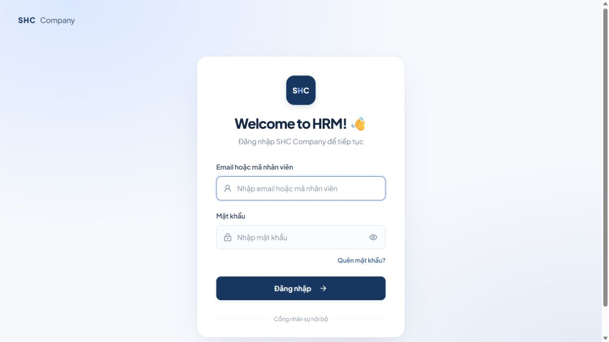
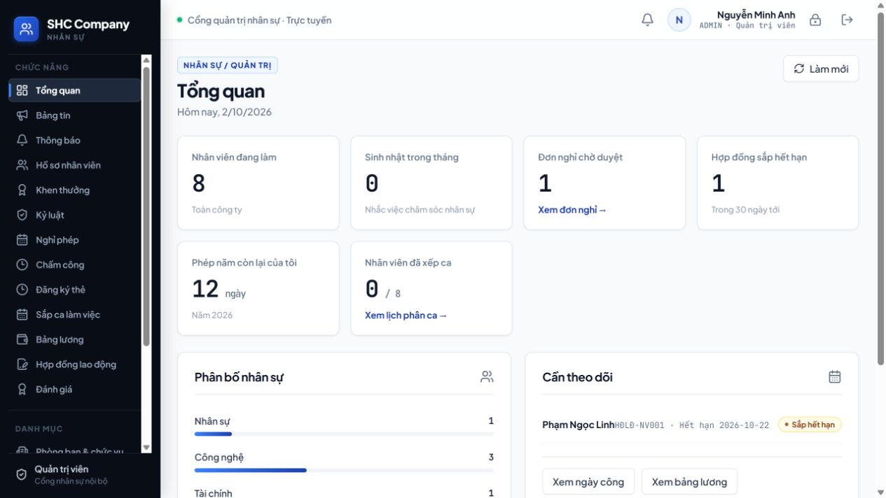
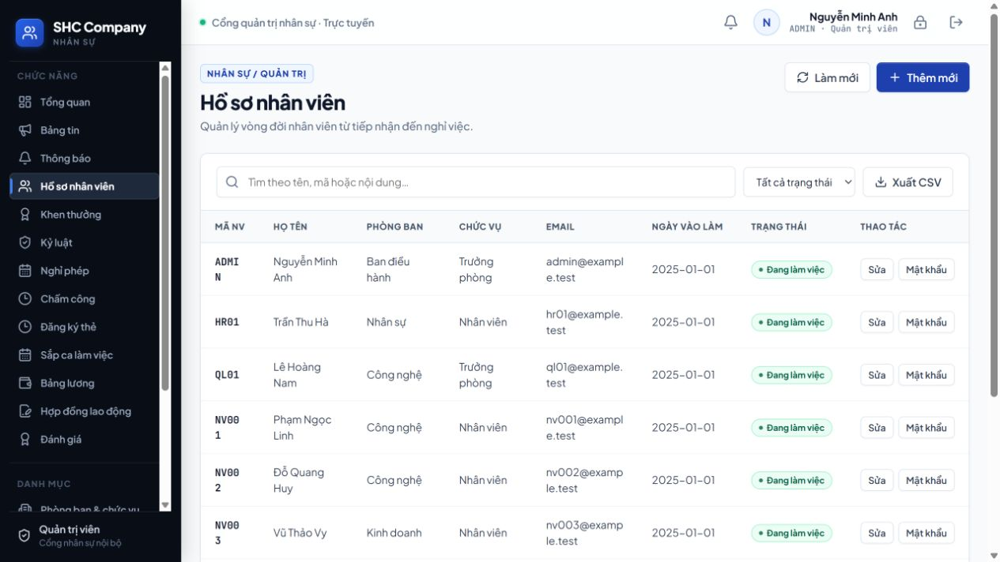
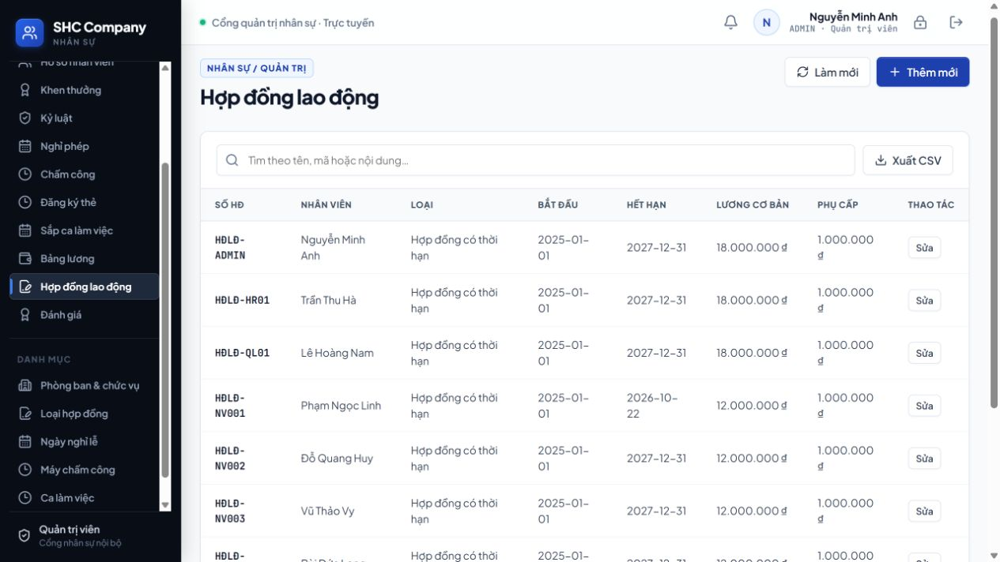
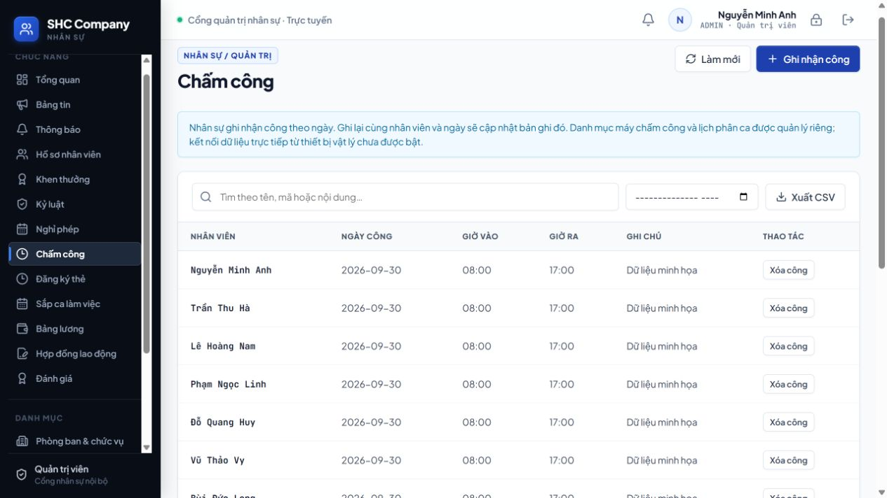
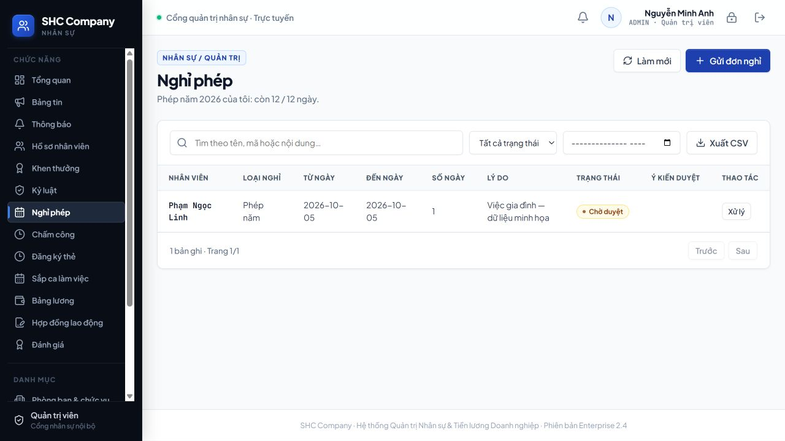
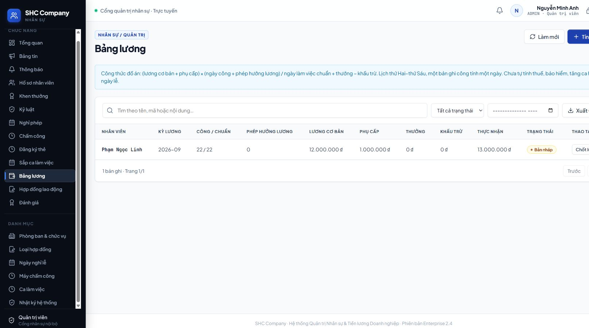
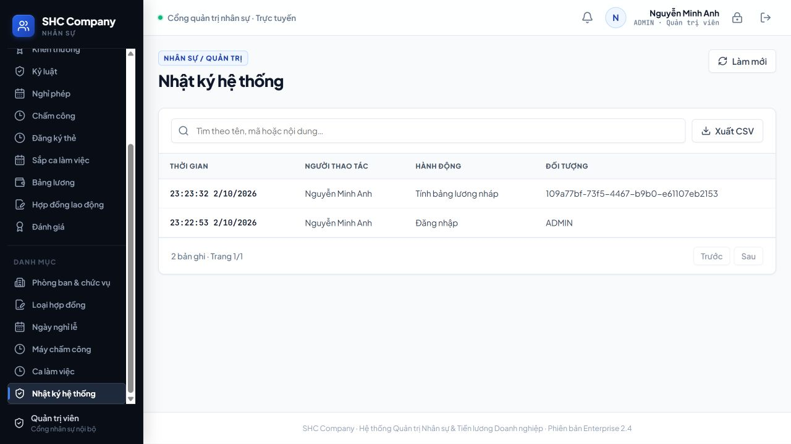

# CHECKPOINT 04 — TRIỂN KHAI CHỨC NĂNG CỐT LÕI

**Đề tài:** Xây dựng hệ thống quản lý nhân sự (SHC Company)
**Sinh viên:** Bùi Đức Dũng — MSV 523100077 — Lớp 523100B
**GVHD:** ThS. Trần Thị Lụa
**Yêu cầu checkpoint (Quy định Đồ án kỳ khóa 523):** Lập trình chức năng cốt lõi, validation, phân quyền nếu cần.
**Minh chứng tối thiểu:** Link Git/commit; ảnh hoặc video sản phẩm chạy.
**Kết quả cần đạt:** Chức năng cốt lõi chạy được trên dữ liệu mẫu.

| Minh chứng | Vị trí |
|---|---|
| Mã nguồn | Thư mục gốc repo này (`src/`, `server.ts`, `scripts/`) |
| Ảnh sản phẩm chạy trên dữ liệu mẫu | [`anh_giao_dien/`](anh_giao_dien/) |
| Hướng dẫn chạy | Mục 3 bên dưới, [`README.md`](../../README.md) |

---

## 1. Môi trường và công nghệ

| Thành phần | Phiên bản / công cụ |
|---|---|
| Node.js | 22.14+ |
| Giao diện | React 19, TypeScript 5.8, Vite 6.4, lucide-react, motion |
| Máy chủ | Express 4, `tsx` |
| Lưu trữ | Tệp JSON qua `HRStore` (ghi nguyên tử) |
| Bảo mật | `node:crypto` — scrypt + salt 16 byte, `timingSafeEqual`, token phiên ngẫu nhiên |
| Kiểm thử | `node:test` + `assert/strict` |

## 2. Cấu trúc mã nguồn

| Tệp | Vai trò |
|---|---|
| `server.ts` | Khởi động Express, header bảo mật, gắn router `/api`, phục vụ `dist/` khi chạy production |
| `src/backend/hr/api.ts` | Toàn bộ tuyến API: xác thực, phân quyền, hồ sơ, hợp đồng, công, phép, lương, đánh giá, nghiệp vụ bổ trợ, bảng tin, thông báo, đăng ký |
| `src/backend/hr/rules.ts` | Quy tắc ngày: `parseISODate` chặn ngày không có thật, `workdays` đếm ngày T2–T6, kiểm tra giao khoảng |
| `src/backend/hr/store.ts` | `HRStore`: đọc/ghi JSON, `transaction()` nguyên tử, di trú dữ liệu cũ, `passwordHash` |
| `src/hr/HRApp.tsx` | Cổng nhân sự: điều hướng theo vai trò, các màn hình nghiệp vụ, phân trang, hộp thoại |
| `src/hr/LoginPage.tsx` | Đăng nhập, đăng ký công khai |
| `src/hr/Communication.tsx` | Bảng tin nội bộ, thông báo cá nhân |
| `src/landing/LandingPage.tsx` | Trang giới thiệu tại `/` |
| `scripts/setup-hr.ts` | Tạo tài khoản quản trị đầu tiên, sinh dữ liệu demo, nhập hồ sơ cũ |
| `tests/hr.test.ts` | Bộ kiểm thử tự động (xem CP05) |

## 3. Cách chạy

```powershell
npm ci
$env:HR_DATA_FILE='work/demo/hr.json'
npm run hr:demo        # sinh 8 nhân viên, 8 hợp đồng, 176 bản ghi công, 1 đơn nghỉ
npm run build
npm run start          # mở http://localhost:3000
```

Tài khoản demo: `ADMIN`, `HR01`, `QL01`, `NV001`… Mật khẩu sinh ngẫu nhiên, ghi vào `work/demo/demo-access.txt` (không đưa lên Git). Hoặc chạy nhanh trên Windows: `./Start-Demo.ps1`.

## 4. Chức năng cốt lõi đã triển khai

| Mã | Chức năng | Validation / phân quyền tại máy chủ |
|---|---|---|
| UC01 | Đăng nhập, đăng xuất, đổi mật khẩu, phiên 8 giờ | Bắt buộc mật khẩu (scrypt), giới hạn 20 lần/IP/15 phút, thu hồi phiên khi đổi mật khẩu |
| UC10 | Đăng ký công khai + HR/Admin duyệt kích hoạt | Chỉ tạo yêu cầu chờ duyệt, vai trò cố định employee, kiểm tra Origin, 10 lần/IP/15 phút |
| UC02 | Hồ sơ nhân viên, phòng ban, chức vụ | HR không tạo được admin; nhân viên chỉ xem hồ sơ mình; trưởng phòng chỉ thấy phòng mình, dữ liệu nhạy cảm bị che |
| UC03 | Hợp đồng lao động | Chặn lương âm, chồng thời gian, sửa lương kỳ đã chốt |
| UC05 | Chấm công theo ngày | Chỉ HR/Admin ghi; chặn ngày không có thật; upsert theo (nhân viên, ngày); khóa tháng đã chốt lương |
| UC04 | Nghỉ phép: gửi, hủy, duyệt, từ chối | Chặn trùng ngày, tự duyệt, duyệt khác phòng, duyệt lặp; kiểm hạn mức lúc duyệt; từ chối cần lý do |
| UC06 | Tính lương nháp và chốt lương | Phát hiện nháp lỗi thời (409); nhân viên chỉ thấy lương đã chốt; khóa kỳ đã chốt |
| UC07 | Đánh giá tháng | Thang 0–100; chỉ quản lý/HR/Admin |
| UC08 | Khen thưởng, kỷ luật, thẻ, ca, phân ca, ngày lễ, máy chấm công | Chặn trùng mã thẻ, chồng ca, xóa ca đang dùng |
| UC09 | Bảng tin, thông báo cá nhân, nhật ký | Chỉ HR/Admin đăng tin; phạm vi theo phòng; thông báo riêng từng người |

## 5. Ảnh sản phẩm chạy trên dữ liệu mẫu

| Màn hình | Ảnh |
|---|---|
| Đăng nhập |  |
| Tổng quan (Dashboard) — 8 nhân viên, 1 đơn chờ, 1 hợp đồng sắp hết hạn |  |
| Hồ sơ nhân viên |  |
| Hợp đồng lao động |  |
| Chấm công — 176 bản ghi tháng 09/2026 |  |
| Nghỉ phép — hàng đợi chờ duyệt |  |
| Bảng lương nháp NV001 — 13.000.000 đ |  |
| Nhật ký hệ thống |  |

## 6. Kết quả

Toàn bộ chức năng cốt lõi chạy được trên dữ liệu mẫu; `npm run typecheck:hr` không lỗi, `npm run build` thành công, `npm test` đạt 19/19 (chi tiết ở [CP05](../CP05_kiem_thu/README.md)).
